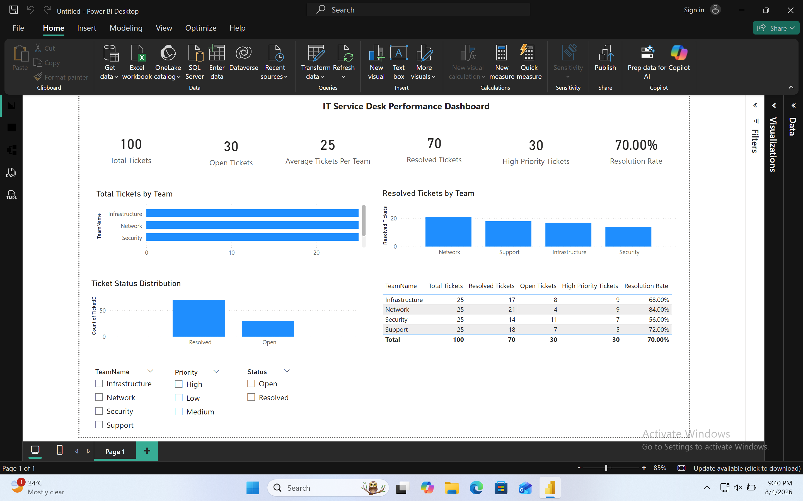

Overview

This project analysed IT Service Desk ticket data using SQL and Power BI to investigate operational performance across support teams. The aim was to identify where ticket backlogs, slower resolution and high-priority incidents were concentrated so managers could better understand workload and service performance.

Analytical Problem

Managers needed a clearer way to identify which support teams were carrying the highest workloads, where unresolved tickets were building up, and whether high-priority incidents were being concentrated in particular areas.

What I Did

- Used SQL to analyse ticket volumes, ticket status, priority and team performance
- Used JOINs, GROUP BY, CASE WHEN, CTEs and Window Functions to investigate patterns across the data
- Built a relational model linking Teams and Tickets through a one-to-many relationship
- Created DAX measures for ticket volumes, resolution rate, high-priority incidents and average workload
- Developed an interactive Power BI dashboard allowing users to analyse performance by team, status and priority
- Used Excel for initial data preparation and validation

Key Metrics

- Total Tickets
- Open Tickets
- Resolved Tickets
- Resolution Rate
- High Priority Tickets
- Average Tickets per Team

Business Value

The dashboard made it easier to identify teams with heavier workloads, areas with higher numbers of unresolved or high-priority tickets, and differences in resolution performance. This gave managers clearer evidence to support workload monitoring, prioritisation and resource allocation.

## Dashboard Preview

